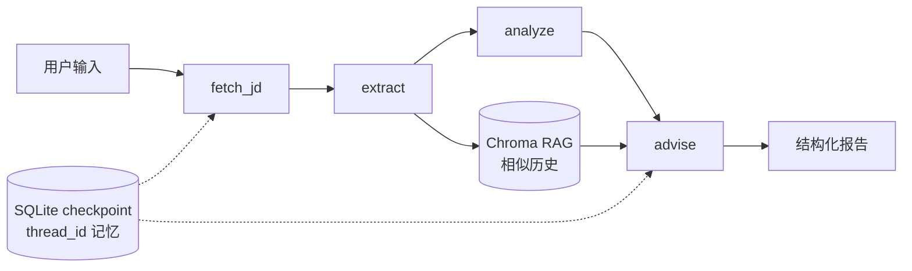

# 职探 JobLens

> **AI 帮你把每一份 JD 看穿看透**

[](LICENSE)
[](https://www.python.org/downloads/)
[](https://github.com/langchain-ai/langgraph)
[](https://www.docker.com/)

## 项目简介

职探 JobLens 吃进一份岗位 JD 和你的简历，输出一份结构化的匹配报告：命中了哪些要求的技能（并从简历里引用证据）、关键缺口在哪、针对性的简历 bullet 改写、以及面试重点。它还会记住你过往的投递，检索出相似岗位，让建议参考你的历史模式而不只看当前这份 JD。写给要投几十家、每份 JD 三分钟读不完的求职者——第一个用户就是作者本人，正在秋招 AI Agent 岗位。

## Demo


职探 JobLens 的结构化匹配报告：总体匹配度、技能逐条匹配（完全 / 部分 / 缺失，带证据）、针对性简历改写建议 —— 全部用 JD 的语言输出。

## 特性

- **4 节点 LangGraph 智能体工作流**，每一步都用 Pydantic 强约束结构化输出
- **持久化记忆（多轮会话）**：基于 LangGraph checkpointer（SQLite）+ `thread_id`，同一会话的多次分析在 checkpoint 恢复的 state 上续跑，支持断点续跑与历史回看（`GET /api/thread/{thread_id}`）
- **Agentic RAG**：用 Chroma 向量库做历史投递匹配（cosine 相似度阈值过滤）
- **反幻觉防御**：schema 校验 + prompt 级 "Do NOT invent" + 从简历引用证据
- **静默 None 失败兜底**：显式 None 检查 + 结构化输出的指数退避重试
- **SSE 实时进度**——节点级流式（fetch → extract → analyze → advise）
- **混合网页抓取**：HTTPX 优先 + Playwright fallback 处理 JS 渲染网站
- **可观测性（可选）**：LangSmith 开箱即接，`.env` 里取消 4 行注释即可追踪每一次 LLM 调用与图节点执行
- **中英双语 UI**，跟随系统的浅色/深色主题
- **Docker Compose 一条命令部署**

## 架构



数据在共享的 `AgentState` 上流转：每个节点消费上游字段、写出自己的产出。`fetch_jd` 纯 IO（无 LLM）；`extract`/`analyze`/`advise` 用 DeepSeek + Pydantic 强约束结构化输出。`advise` 节点从 Chroma 检索相似历史投递，注入自己的 prompt。

记忆链路：`POST /api/analyze`（或 `/stream`）带上 `thread_id` 时，请求改走绑定了 SQLite checkpointer 的图——LangGraph 先从 checkpoint 恢复该会话的历史 state，再在其上增量运行；不带 `thread_id` 则是无状态单次分析（默认路径，行为与 CLI 一致）。

## 快速开始

### 方式 A —— 本地（uv，推荐开发用）

```bash
git clone https://github.com/AlanYy-42/JobLens.git && cd JobLens
uv sync
uv run playwright install chromium        # JS 渲染网站的 fallback 需要
cp .env.example .env                       # 然后填入 LLM_API_KEY（DeepSeek）
uv run uvicorn joblens.api.server:app --port 8000
# 打开 http://localhost:8000
```

### 方式 B —— Docker（推荐类生产环境）

```bash
cp .env.example .env                       # 填入 LLM_API_KEY
docker compose up
# 打开 http://localhost:8000
```

### 方式 C —— CLI（无界面）

```bash
uv run python -m joblens.cli \
    --jd "粘贴 JD 原文或一个 URL" \
    --resume examples/sample_resume.pdf \
    --output result.json
```

### 体验持久化记忆

```bash
# 同一个 thread_id 调两次，第二次会在第一次的 state 基础上续跑
curl -F "jd_text=...岗位职责..." -F "resume_file=@resume.pdf" \
     -F "thread_id=my-search-2026" http://localhost:8000/api/analyze

# 回看该会话最近一次 checkpoint 的 state
curl http://localhost:8000/api/thread/my-search-2026
```

## 配置

环境变量（写在 `.env`，完整注释版见 [.env.example](.env.example)）：

| 变量 | 必填 | 说明 |
| --- | --- | --- |
| `LLM_API_KEY` | ✅ | DeepSeek API key（也兼容旧名 `DEEPSEEK_API_KEY`），从 https://platform.deepseek.com 获取 |
| `LLM_MODEL` | 可选 | 默认 `deepseek-chat`；任何 OpenAI 兼容模型都行 |
| `LLM_BASE_URL` | 可选 | 默认 `https://api.deepseek.com/v1` |
| `EMBEDDING_MODEL` | 可选 | API 模式 / 本地模式共用：配了 `EMBEDDING_BASE_URL` 时为 API 模型名（如 `qwen3.7-text-embedding-flash`），否则为本地 sentence-transformers 模型名（默认 `paraphrase-multilingual-MiniLM-L12-v2`） |
| `EMBEDDING_BASE_URL` | 可选 | 配置后 embedding 走 OpenAI 兼容 `/embeddings` 接口（DashScope 等）；不配则用本地模型，离线可用 |
| `EMBEDDING_API_KEY` | 可选 | API 模式的 key；缺省回退 `LLM_API_KEY`（同一服务商时无需单独配） |
| `CHROMA_DIR` | 可选 | 向量库位置（默认 `~/.joblens/chroma`） |
| `SQLITE_PATH` | 可选 | 历史库位置（默认 `~/.joblens/history.db`） |
| `CHECKPOINT_PATH` | 可选 | LangGraph checkpoint 库位置（默认 `~/.joblens/checkpoints.db`） |
| `CORS_ORIGINS` | 可选 | 允许的前端来源，默认本机 `localhost:8000,5173` |
| `LANGCHAIN_TRACING_V2` 等 | 可选 | LangSmith 追踪开关，见 `.env.example` 末尾注释段 |

## 已知限制

诚实标注，不掩盖：

- **DeepSeek function-calling 不稳定**：长结构化输出偶发失败（`advise` 节点最受影响）。用 3 次指数退避重试缓解；残留失败率约 5–10%。理由：根因是上游 API 的抖动——把重试次数调更高只会*掩盖*现实，而非修复它。遇到失败重跑即可。
- **max_tokens 截断**：把 DeepSeek 上限提到 8192，并给每个节点加 None 兜底，把静默截断变成显式错误。
- **Playwright 抓取边界**：不绕过反爬。BOSS 直聘 / LinkedIn / 脉脉（登录墙 + 强反爬）**不支持**。建议直接粘贴 JD 文本——效果完全一样。
- **Embedding 只到表层语义**：区分不了"FinTech 的 AI Agent"和"电商的 AI Agent"这种业务领域差异。未来：加 rerank 层。
- **单用户部署**：无鉴权、无多租户。面向个人使用，不是 SaaS。

## 路线图

- `advise` 节点自然语言字段的 token 级流式
- rerank 层，把 RAG 精度提升到表层语义之上
- 多模型 failover（反复失败时 DeepSeek → GPT-4）
- 通过 Cloudflare Tunnel 公网部署（暂不提供——成本/合规考量）

## 技术栈

- **语言**：Python 3.11+
- **Agent 框架**：LangGraph（StateGraph + checkpointer 持久化记忆）, LangChain
- **LLM**：DeepSeek（OpenAI 兼容接口，模型/base_url 均可 env 切换）
- **结构化输出**：Pydantic 2.x（function calling）
- **向量库**：Chroma
- **Embedding**：双模式 —— 配 `EMBEDDING_BASE_URL` 走 OpenAI 兼容 API（如 DashScope `qwen3.7-text-embedding-flash`），不配则用本地 sentence-transformers（`paraphrase-multilingual-MiniLM-L12-v2`）
- **后端**：FastAPI + uvicorn（SSE 用 `StreamingResponse`）
- **前端**：原生 HTML/JS/CSS（无构建步骤）
- **PDF 解析**：pdfplumber + pypdfium2 fallback
- **网页抓取**：httpx + Playwright fallback
- **持久化**：SQLite（历史 + checkpoint）+ Chroma（向量）
- **可观测**：LangSmith（可选，env 开关）
- **部署**：Docker + Docker Compose

## 项目结构

```
JobLens/
├── src/joblens/
│   ├── graph.py          # LangGraph 主图（可注入 checkpointer）
│   ├── memory.py         # SQLite checkpoint 持久化记忆（thread_id）
│   ├── state.py          # AgentState + Pydantic 结构化输出 schema
│   ├── config.py         # 全部 LLM/Embedding/CORS 配置走环境变量
│   ├── nodes/            # fetch_jd / extract / analyze / advise 四节点
│   ├── rag/              # Chroma 向量库 + 多语言 Embedding
│   ├── api/              # FastAPI：analyze / stream(SSE) / thread / history
│   ├── history/          # SQLite 投递历史存档
│   ├── tools/            # PDF 解析、网页抓取
│   └── web/static/       # 原生前端（无构建）
├── tests/                # pytest：图节点 / RAG / API / 记忆（43 passed）
├── examples/             # 示例简历与示例报告
└── docker-compose.yml
```

## 致谢

- LangGraph & LangChain 团队
- DeepSeek 提供实惠的 LLM 推理
- Chroma 的嵌入式向量库
- UKPLab 的 sentence-transformers
- Lucide icons

## 许可

[MIT](LICENSE)
